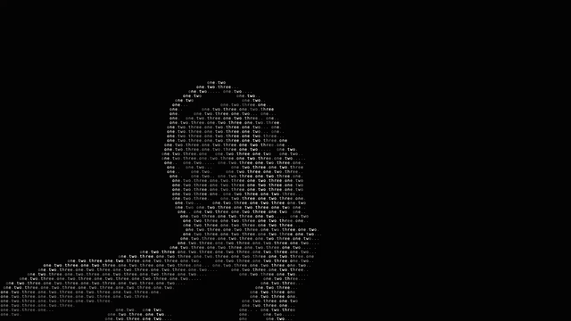

# Speech Figure

Speech Figure is a creative-coding project: live speech recognition that runs on your own computer and turns what you say into a transcript, subtitles and your own silhouette made of words. Nothing is uploaded: recognition is [Whisper](https://github.com/openai/whisper) running in the browser, on the GPU when WebGPU is available.



*The words in the figure are what was said out loud. A silent demo clip; [watch it as an MP4](docs/demo.mp4).*

## What it does

- **Local, live transcription.** Whisper runs in a Web Worker, so the page stays responsive. Phrases are cut at pauses, and a partial transcript updates while you are still talking.
- **Russian and English mixed.** The language of each phrase is detected on its own (Russian or English), so you can switch mid-conversation. Other languages (Portuguese, Ukrainian) can be picked by hand.
- **Transcript you can keep.** Every phrase gets start/end times and a language tag. Copy it, or save it as `.txt` or `.srt` (subtitles with timestamps).
- **Large subtitles** in a plain font, over the picture, fading out after a few seconds.
- **Your words as the picture.** With the camera on, the transcribed words fill your silhouette and run along threads between your fingertips. The newest phrase floods the figure from top to bottom and glows.
- **Performance mode.** One switch for speech, subtitles and fullscreen (plus hands and the word figure when the camera is on), meant for live shows.
- **Two ways to start.** *Camera + speech*, or *Listen only* (microphone, no camera), where the words fall as rain behind the subtitles.
- **Recording with sound.** Record the output to MP4 (H.264 + AAC) or WebM (VP9 + Opus). The microphone is recorded along with the picture; untick **Record sound** to make a silent video. Video-file mode exports are silent.

There is also a visual-effects side: hands and gestures, mouth smoke, falling-code rain, and a video-file mode that renders a clip as a figure of code. These are optional and independent of speech.

## Requirements

- Google Chrome (WebGPU, WebCodecs and MediaRecorder are used). Developed and tested on macOS with Apple Silicon.
- Node.js 18 or newer.
- A microphone. A webcam for the camera modes.

## Quick start

```bash
git clone <this repo>
cd speech-figure
npm install
npm run setup:speech     # Whisper (small) plus the MediaPipe models, about 700 MB
npm start                # open http://localhost:5173 in Chrome
```

On macOS you can also double-click `start.command`.

Lighter install: `npm run setup:speech -- --model base` (about 335 MB in total; faster, but understands Russian less well; pick **Fast** in the Whisper model selector). `--model both` installs both. If you only want the visual effects and no speech, `npm run setup` downloads just the MediaPipe models (about 50 MB).

## Using it

1. Press **Start: camera + speech** or **Listen only**. Allow the microphone (and the camera). The first start loads the Whisper model, which can take up to about 30 seconds; the status line under the transcript says what is happening.
2. Speak. Partial text appears while you talk, and the final text replaces it a moment after you pause.
3. Use **Copy**, **Save .txt** or **Save .srt** under the transcript at any time. **Clear** empties it.
4. For a show, tick **Performance mode: fullscreen**. `F` toggles fullscreen and `Esc` leaves it.

Settings worth knowing:

| Setting | What it does |
| --- | --- |
| Speech engine | *Whisper* (local, default) or *Chrome* (Chrome's built-in service; faster to start, but one language and it sends audio to Google) |
| Whisper model | *Accurate* (`small`) or *Fast* (`base`) |
| Speech language | *Auto* (Russian + English per phrase) or one fixed language |
| React to sound | microphone level drives the rain speed |

## Accuracy and speed

On an Apple-silicon Mac, a short phrase is transcribed in roughly one to two seconds on the GPU (several seconds on the CPU), and a phrase appears about a second or two after you stop talking. Accuracy depends on your microphone, the room and the model: `small` is clearly better than `base`, especially for Russian. Whisper can occasionally invent text on silence or noise; known cases are filtered out. I tested the pipeline with synthetic voices, not with a broad set of real speakers, so expect to try it with your own voice and microphone.

## Privacy

Everything runs locally. Audio and video never leave your computer with the default engine. The only network use is downloading libraries and models during `npm run setup`. The optional **Chrome** engine uses Chrome's own speech service, which sends audio to Google; the interface says so.

## How it works

| File | What it does |
| --- | --- |
| `public/speech.js`, `public/speech-worker.js` | Voice-activity detection (cuts phrases at pauses, emits partial audio) and Whisper (transformers.js + ONNX Runtime Web, WebGPU with a CPU fallback) in a Web Worker, with per-phrase language detection |
| `public/app.js` | Interface, transcript and export, live loops (camera and listen-only), subtitles, hands, face, audio, video export |
| `public/engine.js` | Frame to character grid, person segmentation and background model, glyph renderer, word figure, rain, threads, sparks |
| `server.mjs` | Tiny local static server on `127.0.0.1` with range requests and cross-origin isolation headers (needed for multithreaded WASM) |
| `scripts/setup.mjs` | Copies browser libraries from `node_modules` and downloads the models |

## Troubleshooting

- **Microphone or camera does not start:** allow it in Chrome (address-bar icon) and in macOS System Settings, Privacy and Security.
- **"The speech model did not load":** run `npm run setup:speech` (add `-- --model base` if you installed the light model and picked **Fast**).
- **Transcription is slow:** the status line should say it runs "on the GPU". On the CPU use the Fast model, or fix the language instead of Auto.
- **Words look wrong in a language other than Russian or English:** choose that language explicitly under **Speech language**.
- **The page freezes:** turn off the heaviest camera effects (mouth smoke, the figure) or lower the preview resolution under **Quality**.

## Credits and licenses of third-party components

OpenAI Whisper (MIT) with ONNX conversions by Xenova, transformers.js (Apache-2.0), ONNX Runtime Web (MIT), MediaPipe Tasks Vision and its models (Apache-2.0), mp4-muxer and webm-muxer by Vanilagy (MIT). Models and libraries are downloaded by the setup script and are not committed to this repository.

## License

[PolyForm Noncommercial 1.0.0](LICENSE). In short:

- **Free for noncommercial use:** personal projects, hobby and art projects, research, study, education, charities, public institutions. You can read it, run it, change it and share it, as long as you keep the license text and the line `Required Notice: Copyright (c) 2026 Sasha Nagiba` with every copy.
- **Commercial use needs permission.** If you want to use it in a product, a paid service, client work or inside a company, write to the author first: [s.nagiba@proton.me](mailto:s.nagiba@proton.me). Credit and terms are agreed case by case.

This is a "source-available" license, not an OSI open-source one. It covers this repository's own code only: the libraries and models it downloads keep their own licenses (see above).

---

Made by Sasha Nagiba.
